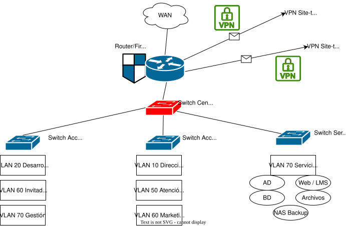

# Inventario Inicial de Hardware

| Categoría | Sede | Cantidad estimada | Uso principal |
|---|---|---:|---|
| Router/firewall | Porto | 1 | Seguridad perimetral, VPN, NAT e Internet |
| Router/firewall | Braga | 1 | Conexión segura con Porto mediante VPN |
| Router/firewall | Coímbra | 1 | Conexión segura con Porto mediante VPN |
| Switch gestionable core | Porto | 1 | Distribución principal de la red y VLANs |
| Switch gestionable acceso | Porto | 2 | Conexión de equipos, impresoras y APs |
| Switch gestionable acceso | Braga | 1 | Conexión de usuarios y APs |
| Switch gestionable acceso | Coímbra | 1 | Conexión de usuarios y APs |
| Puntos de acceso Wi-Fi | Porto | 4 | Wi-Fi corporativo e invitados |
| Puntos de acceso Wi-Fi | Braga | 2 | Wi-Fi corporativo e invitados |
| Puntos de acceso Wi-Fi | Coímbra | 2 | Wi-Fi corporativo e invitados |
| Servidor físico | Porto | 1 | Virtualización de servicios internos |
| NAS principal | Porto | 1 | Archivos compartidos y copias locales |
| NAS de respaldo | Braga | 1 | Replicación externa de backups |
| UPS | Todas las sedes | 4 | Protección eléctrica |
| Equipos de usuario | Todas las sedes | 60 + 5 reserva | Puestos de trabajo |
| Impresoras multifunción | Todas las sedes | 4 | Impresión y escaneo |

## Porto

### Resumen de usuarios

| Área / Departamento            | Usuarios |
| ------------------------------ | -------: |
| Dirección y Administración     |        8 |
| IT / Sistemas                  |        5 |
| Desarrollo y Plataforma Online |        2 |
| Atención al Cliente            |        3 |
| Marketing y Ventas             |        6 |
| **Usuarios estimados**         |   **24** |

### Esquemática Teórica

- Diagrama abstracto jerárquico que separa lógicamente cada departamento mediante VLANs.
- La VLAN 70 agrupa la gestión de red y los servidores internos, administrados por el departamento de IT / Sistemas.

## Braga

### Resumen de usuarios

| Área / Departamento        | Usuarios |
| -------------------------- | -------: |
| Equipo Académico           |       18 |
| Atención al Cliente        |        7 |
| Invitados Wi-Fi            | Variable |
| Gestión de red             | Solo IT  |
| **Usuarios estimados**     |   **25** |

### Esquemática Teórica

## Coímbra

### Resumen de usuarios

| Área / Departamento    | Usuarios |
| ---------------------- | -------: |
| Equipo Académico       |       10 |
| Atención al Cliente    |        1 |
| Invitados Wi-Fi        | Variable |
| Gestión de red         | Solo IT  |
| **Usuarios estimados** |   **11** |

### Esquemática Teórica

# Diseño Físico de la Red

La infraestructura física se dividirá en tres sedes: Porto, Braga y Coímbra. La sede principal de Porto alojará la mayor parte de la infraestructura crítica, incluyendo servidores, NAS, firewall principal y switches principales. Las sedes de Braga y Coímbra tendrán una infraestructura más sencilla, centrada en la conectividad de usuarios y la conexión segura con Porto mediante VPN site-to-site.

| Sede | Equipamiento principal | Observaciones |
|---|---|---|
| Porto | Router/firewall, switch central, switches de acceso, servidores, NAS, puntos Wi-Fi, UPS y rack | Sede principal y centro de la infraestructura |
| Braga | Router/firewall, switch gestionable, puntos Wi-Fi, UPS y pequeño rack | Sede secundaria conectada a Porto mediante VPN |
| Coímbra | Router/firewall, switch gestionable, puntos Wi-Fi, UPS y pequeño rack | Sede secundaria centrada en equipo académico y pequeña presencia de atención al cliente |

## Hardware físico - Porto

| Elemento | Cantidad | Ubicación | Función |
|---|---:|---|---|
| Router/firewall | 1 | Rack principal / sala técnica | Seguridad perimetral, NAT, VPN site-to-site y acceso a Internet |
| Switch central gestionable | 1 | Rack principal | Distribución de red, VLANs y conexión con switches de acceso y servidores |
| Switches de acceso gestionables | 2 | Rack principal / armario de red | Conexión de equipos de usuario, impresoras y puntos Wi-Fi |
| Servidor físico principal | 1 | Sala técnica | Virtualización de servicios internos |
| NAS principal | 1 | Sala técnica | Almacenamiento compartido y copias de seguridad locales |
| Puntos de acceso Wi-Fi | 4 | Zonas de oficina y salas comunes | Wi-Fi corporativo e invitados |
| UPS/SAI | 2 | Sala técnica / rack | Protección eléctrica de servidores y red |
| Impresoras multifunción | 2 | Administración y zona común | Impresión y escaneo |
| Puestos de usuario | 24 | Oficinas y puestos de trabajo | Equipos para empleados |

## Hardware físico - Braga

| Elemento | Cantidad | Ubicación | Función |
|---|---:|---|---|
| Router/firewall | 1 | Rack/armario de comunicaciones | VPN site-to-site con Porto, firewall y salida a Internet |
| Switch gestionable | 1 | Armario de comunicaciones | Distribución de VLANs locales |
| Puntos de acceso Wi-Fi | 2 | Zona de oficina y sala común | Wi-Fi corporativo e invitados |
| UPS/SAI | 1 | Armario de comunicaciones | Protección eléctrica de red |
| Impresora multifunción | 1 | Zona administrativa | Impresión y escaneo |
| Puestos de usuario | 25 | Oficinas y puestos de trabajo | Equipo académico y atención al cliente |

## Hardware físico - Coímbra

| Elemento | Cantidad | Ubicación | Función |
|---|---:|---|---|
| Router/firewall | 1 | Armario de comunicaciones | VPN site-to-site con Porto, firewall y salida a Internet |
| Switch gestionable | 1 | Armario de comunicaciones | Distribución de VLANs locales |
| Puntos de acceso Wi-Fi | 2 | Zona de oficina | Wi-Fi corporativo e invitados |
| UPS/SAI | 1 | Armario de comunicaciones | Protección eléctrica de red |
| Impresora multifunción | 1 | Zona común | Impresión y escaneo |
| Puestos de usuario | 11 | Oficinas y puestos de trabajo | Equipo académico y atención al cliente |

## Esquema de cableado

Se utilizará cableado estructurado **Cat6** para la conexión de puestos de trabajo, impresoras, puntos de acceso Wi-Fi y dispositivos de red. En la sede de Porto, los enlaces entre el switch central, servidores y NAS podrán utilizar enlaces de mayor velocidad, como 10 GbE o fibra/SFP+, si el presupuesto lo permite.

| Tipo de conexión | Cableado recomendado | Uso |
|---|---|---|
| Puestos de usuario | Cat6 | Conexión de PCs, teléfonos IP e impresoras |
| Puntos de acceso Wi-Fi | Cat6 con PoE | Alimentación y datos para APs |
| Switch central a switches de acceso | Cat6 / fibra SFP | Enlaces troncales entre switches |
| Servidores y NAS | Cat6 / 10 GbE | Conexión de alta velocidad a la red interna |
| Conexión entre sedes | VPN sobre Internet | Comunicación segura entre Porto, Braga y Coímbra |

## 2. Especificaciones de los servidores

Se utilizará virtualización en la sede principal de Porto para centralizar los servicios internos de la empresa. El servidor físico principal ejecutará varias máquinas virtuales, permitiendo separar servicios y facilitar la administración, mantenimiento y copias de seguridad.

- **Software de virtualización:** Proxmox VE
- **Ubicación:** Sede principal de Porto
- **Servidor físico principal:** Dell PowerEdge
- **Departamento responsable:** IT / Sistemas

| Máquina virtual | Sistema operativo | CPU | RAM | Disco | Función |
|---|---|---:|---:|---:|---|
| DC01 | Windows Server | 2 vCPU | 4 GB | 80 GB | Active Directory y DNS |
| DHCP01 | Windows Server / Ubuntu Server | 1 vCPU | 2 GB | 40 GB | DHCP por VLAN |
| FILE01 | Windows Server / Ubuntu Server | 2 vCPU | 4 GB | 500 GB | Archivos compartidos |
| WEB01 | Ubuntu Server | 2 vCPU | 4 GB | 80 GB | Web corporativa y plataforma LMS |
| DB01 | Ubuntu Server | 2 vCPU | 6 GB | 150 GB | Base de datos MySQL/MariaDB |
| BACKUP01 | NAS / Linux | 2 vCPU | 4 GB | 1-2 TB | Copias de seguridad locales |

| Servidor físico | CPU | RAM | Almacenamiento | Uso |
|---|---|---:|---|---|
| Servidor principal Porto | Intel Xeon / AMD EPYC | 64 GB | SSD para sistema | Virtualización de servicios internos |
| NAS Porto | CPU NAS dedicada | 8-16 GB | 4 bahías | Archivos compartidos y backups |
| NAS Braga | CPU NAS dedicada | 8 GB | 4 bahías | Copia externa de respaldo |

## 3. Plan de direccionamiento IP

Se utilizará direccionamiento privado dividido por sedes. Cada sede tendrá un rango principal y las VLANs se organizarán mediante subredes independientes. La numeración de VLANs será coherente entre sedes, utilizando el mismo número para la misma función.

| Sede | Rango principal |
|---|---|
| Porto | `10.10.0.0/16` |
| Braga | `10.20.0.0/16` |
| Coímbra | `10.30.0.0/16` |

### Esquema de VLANs

| VLAN | Función |
|---:|---|
| 10 | Dirección y Administración |
| 20 | Desarrollo y Plataforma Online |
| 30 | Equipo Académico |
| 40 | Atención al Cliente |
| 50 | Marketing y Ventas |
| 60 | Invitados Wi-Fi |
| 70 | Gestión de red y Servidores |

### Subredes por sede

| Sede | VLAN | Nombre | Red | Gateway |
|---|---:|---|---|---|
| Porto | 10 | Dirección y Administración | `10.10.10.0/24` | `10.10.10.1` |
| Porto | 20 | Desarrollo y Plataforma Online | `10.10.20.0/24` | `10.10.20.1` |
| Porto | 40 | Atención al Cliente | `10.10.40.0/24` | `10.10.40.1` |
| Porto | 50 | Marketing y Ventas | `10.10.50.0/24` | `10.10.50.1` |
| Porto | 60 | Invitados Wi-Fi | `10.10.60.0/24` | `10.10.60.1` |
| Porto | 70 | Gestión de red y Servidores | `10.10.70.0/24` | `10.10.70.1` |
| Braga | 30 | Equipo Académico | `10.20.30.0/24` | `10.20.30.1` |
| Braga | 40 | Atención al Cliente | `10.20.40.0/24` | `10.20.40.1` |
| Braga | 60 | Invitados Wi-Fi | `10.20.60.0/24` | `10.20.60.1` |
| Braga | 70 | Gestión de red | `10.20.70.0/24` | `10.20.70.1` |
| Coímbra | 30 | Equipo Académico | `10.30.30.0/24` | `10.30.30.1` |
| Coímbra | 40 | Atención al Cliente | `10.30.40.0/24` | `10.30.40.1` |
| Coímbra | 60 | Invitados Wi-Fi | `10.30.60.0/24` | `10.30.60.1` |
| Coímbra | 70 | Gestión de red | `10.30.70.0/24` | `10.30.70.1` |

### IPs fijas principales

| Dispositivo / Servicio | Sede | IP |
|---|---|---|
| Router/firewall Porto | Porto | `10.10.70.1` |
| DC01 / DNS | Porto | `10.10.70.10` |
| DHCP01 | Porto | `10.10.70.11` |
| FILE01 | Porto | `10.10.70.20` |
| WEB01 / LMS | Porto | `10.10.70.30` |
| DB01 | Porto | `10.10.70.40` |
| NAS Porto | Porto | `10.10.70.50` |
| NAS Braga | Braga | `10.20.70.50` |
| Router/firewall Braga | Braga | `10.20.70.1` |
| Router/firewall Coímbra | Coímbra | `10.30.70.1` |

## Rangos dinámicos DHCP

| Sede | VLAN | Rango DHCP |
|---|---:|---|
| Porto | VLAN 10 | `10.10.10.100 - 10.10.10.200` |
| Porto | VLAN 20 | `10.10.20.100 - 10.10.20.200` |
| Porto | VLAN 40 | `10.10.40.100 - 10.10.40.200` |
| Porto | VLAN 50 | `10.10.50.100 - 10.10.50.200` |
| Porto | VLAN 60 | `10.10.60.100 - 10.10.60.200` |
| Braga | VLAN 30 | `10.20.30.100 - 10.20.30.200` |
| Braga | VLAN 40 | `10.20.40.100 - 10.20.40.200` |
| Braga | VLAN 60 | `10.20.60.100 - 10.20.60.200` |
| Coímbra | VLAN 30 | `10.30.30.100 - 10.30.30.200` |
| Coímbra | VLAN 40 | `10.30.40.100 - 10.30.40.200` |
| Coímbra | VLAN 60 | `10.30.60.100 - 10.30.60.200` |

> La VLAN 70 de gestión de red y servidores utilizará principalmente direcciones IP fijas para evitar cambios en dispositivos críticos.

## 4. Plan de instalación

La implantación se realizará por fases para reducir riesgos y facilitar la comprobación de cada servicio antes de pasar al siguiente.

| Fase | Tareas principales |
|---|---|
| 1. Preparación física | Instalación de racks, cableado Cat6, patch panels, UPS y etiquetado |
| 2. Red base | Instalación de router/firewall, switches, VLANs y conectividad entre sedes |
| 3. Servicios base | Instalación de Active Directory, DNS, DHCP y políticas iniciales |
| 4. Seguridad | Configuración de firewall, VPN site-to-site, antivirus y permisos |
| 5. Servidores internos | Instalación de servidor de archivos, base de datos, web/LMS y NAS |
| 6. Clientes | Configuración de equipos de usuario, unión al dominio y pruebas de acceso |
| 7. Backups | Configuración de copia incremental diaria, copia completa semanal y replicación externa hacia Braga |
| 8. Pruebas finales | Comprobación de conectividad, permisos, restauración y acceso remoto |
| 9. Documentación | Inventario, manuales técnicos, credenciales seguras y procedimientos |