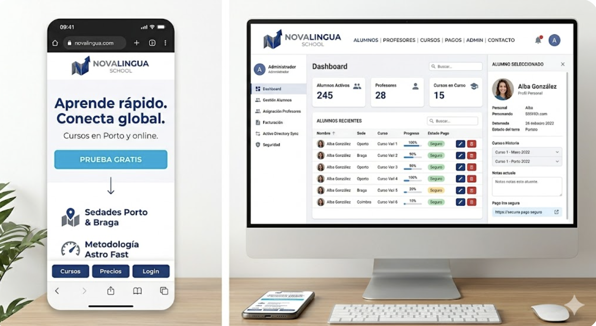

Plantilla para el análisis de requerimientos de la infraestructura informática de una empresa ficticia. Debes adaptarla a tu proyecto.

# 📋 Análisis de Requerimientos - Proyecto de Infraestructura Informática

## 1. Información General de la Empresa

- **Nombre de la empresa:** NovaLingua School
- **Sector de actividad:** Academia de idiomas
- **Número de empleados:** 65
- **Ubicación física:** Portugal
  - **Oficina principal:** Rua de Fernandes Tomás 557, 4000-049 Porto, Portugal
  - **Otras sedes:** Braga, Coímbra
- **¿Se permite teletrabajo?:** Sí

## 2. Estructura Organizativa

| Departamento                   | Nº usuarios | Ubicación principal      | Función principal                                           |
| ------------------------------ | ----------: | ------------------------ | ----------------------------------------------------------- |
| Dirección y Administración     |           8 | Porto                    | Gestión general, finanzas, facturación y tareas de RRHH     |
| IT / Sistemas                  |           5 | Porto                    | Servidores, red, usuarios, seguridad y copias de seguridad  |
| Desarrollo y Plataforma Online |           8 | Porto                    | Sitio web, LMS, plataforma de alumnos y base de datos       |
| Equipo Académico               |          28 | Braga / Coimbra / remoto | Profesores, coordinadores académicos y clases online        |
| Atención al Cliente            |          10 | Porto / Braga            | Soporte a estudiantes, consultas sobre cursos e incidencias |
| Marketing y Ventas             |           6 | Porto                    | Publicidad, redes sociales, ventas y colaboraciones         |
| **Total**                      |      **65** |                          |                                                             |

## 3. Necesidades Funcionales

- **Servicios informáticos requeridos:**
  - [x] Correo electrónico empresarial
  - [x] Almacenamiento y compartición de archivos
  - [x] Servidor web corporativo
  - [x] Gestión de usuarios y permisos (Active Directory)
  - [x] Servidor de base de datos
  - [x] Aplicaciones específicas (si da tiempo - una aplicación móvil)
  - [x] Acceso remoto (VPN, Escritorio Remoto)

## 4. Requisitos Técnicos

### 4.1 Red

- **Topología deseada:** Estrella jerárquica 
- **Segmentación de red:** Sí - uso de VLANs
- **Firewall / Seguridad perimetral:** Sí
- **Wi-Fi corporativo:** Sí - acceso invitados separado

#### Diseño VLANs y IP
Rangos potenciales:
| Office  | Main range     |
| ------- | -------------- |
| Porto   | `10.10.0.0/16` |
| Braga   | `10.20.0.0/16` |
| Coimbra | `10.30.0.0/16` |

- Es esencial dividir cada sitio en cuanto a su función para crear un nivel alto de seguridad. Por ejemplo, lo siguiente puede ser un ejemplo de cómo se dividiría cada sede:

##### VLANs - Porto
|                        VLAN | Network         | Gateway      |
| --------------------------: | --------------- | ------------ |
| 10 Dirección-Administración | `10.10.10.0/24` | `10.10.10.1` |
|              20 IT-Sistemas | `10.10.20.0/24` | `10.10.20.1` |
|    30 Desarrollo-Plataforma | `10.10.30.0/24` | `10.10.30.1` |
|         50 Atención-Cliente | `10.10.50.0/24` | `10.10.50.1` |
|         60 Marketing-Ventas | `10.10.60.0/24` | `10.10.60.1` |
|               70 Servidores | `10.10.70.0/24` | `10.10.70.1` |
|                80 Invitados | `10.10.80.0/24` | `10.10.80.1` |
|     90 Gestión/Admin de red | `10.10.90.0/24` | `10.10.90.1` |

- Braga y Coímbra no necesitan tantos VLANs ya que no contienen la infraestructura crítica de la red en general. Tiene en mente la separación por acceso. Por ejemplo, todos los invitados no tienen acceso al resto de la red. Si un atacante invadiera al VLAN invitado, no podrían acceder a la sección de servidores, IT etc. Por defecto se bloquea todo y luego se permite comunicación entre VLANs. Por ejemplo, IT tendría acceso a todos VLANs, Dirección a los servidores, Atención al Cliente, Marketing, y IT, etc. 

##### VLANs - Braga
|                VLAN | Network         | Gateway      |
| ------------------: | --------------- | ------------ |
|        40 Académico | `10.20.40.0/24` | `10.20.40.1` |
| 50 Atención-Cliente | `10.20.50.0/24` | `10.20.50.1` |
|        80 Invitados | `10.20.80.0/24` | `10.20.80.1` |
|          90 Gestión | `10.20.90.0/24` | `10.20.90.1` |

- Braga se centra en atención al cliente.

##### VLANs - Coímbra
|         VLAN | Network         | Gateway      |
| -----------: | --------------- | ------------ |
| 40 Académico | `10.30.40.0/24` | `10.30.40.1` |
| 80 Invitados | `10.30.80.0/24` | `10.30.80.1` |
|   90 Gestión | `10.30.90.0/24` | `10.30.90.1` |

- Coímbra se centra en el contenido académico. 

##### Ejemplo de Topología Estrella (generada por IA, solo para primeras visualizaciones)
Internet
   |
Router/Firewall Porto
   |
Core Switch Porto
   |
   +-- VLAN 10: Dirección y Administración
   +-- VLAN 20: IT / Sistemas
   +-- VLAN 30: Desarrollo y Plataforma Online
   +-- VLAN 70: Servidores
   |      +-- Active Directory
   |      +-- DNS
   |      +-- DHCP
   |      +-- Web / LMS
   |      +-- Base de Datos
   |      +-- Archivos / NAS
   |
   +-- VLAN 80: Invitados Wi-Fi
   |
   +-- VPN site-to-site --> Router/Firewall Braga
   |                         |
   |                         +-- Switch Braga
   |                              +-- VLAN 40: Equipo Académico
   |                              +-- VLAN 50: Atención al Cliente
   |                              +-- VLAN 80: Invitados Wi-Fi
   |
   +-- VPN site-to-site --> Router/Firewall Coímbra
                             |
                             +-- Switch Coímbra
                                  +-- VLAN 40: Equipo Académico
                                  +-- VLAN 80: Invitados Wi-Fi
                                  +-- VLAN 90: Gestión

### 4.2 Servidores

| Servicio | ¿Necesario? | Tipo de servidor | Observaciones |
|---|---|---|---|
| DNS | Sí | Windows/Linux | Resolución interna de nombres para equipos, servidores y servicios de la empresa |
| DHCP | Sí | Windows/Linux | Asignación automática de direcciones IP en las distintas sedes y VLANs |
| Active Directory | Sí | Windows Server | Gestión centralizada de usuarios, grupos, permisos y políticas de seguridad |
| Archivos compartidos | Sí | Windows/Linux / NAS | Almacenamiento compartido para departamentos, material académico, documentación interna y copias de seguridad |
| Web corporativa y plataforma online | Sí | Apache/Nginx | Página pública de la empresa y acceso privado para estudiantes, profesores y administración |
| Base de datos | Sí | MySQL/MariaDB | Almacenamiento de usuarios, cursos, matrículas, horarios, pagos, incidencias y contenidos de la plataforma |

### 4.3 Seguridad

- **Políticas de acceso:** Autenticación centralizada mediante Active Directory, con usuarios agrupados por departamento y permisos basados en roles. Se aplicará el principio de mínimo privilegio, de forma que cada empleado solo pueda acceder a los recursos necesarios para su trabajo. El personal de administración tendrá acceso a documentación interna y facturación, el equipo académico a materiales docentes, atención al cliente a incidencias y datos básicos de alumnos, y el departamento de IT a la administración de sistemas.

- **Backups:** Se realizarán copias incrementales diarias y copias completas semanales de servidores, bases de datos, plataforma online y carpetas compartidas. Las copias se almacenarán en un NAS local en la sede principal de Porto (con un servidor de respaldo en Braga). Se conservarán copias durante 30 días y se realizarán pruebas periódicas de restauración.

| Tipo de copia | Frecuencia | Ubicación | Objetivo |
|---|---|---|---|
| Incremental | Diaria | NAS local en Porto | Restauración rápida de cambios recientes |
| Completa | Semanal | NAS local en Porto | Copia completa de servidores y datos críticos |
| Replicación externa | Diaria | NAS de respaldo en Braga | Recuperación ante desastres en la sede principal |
| Prueba de restauración | Mensual | Porto / Braga | Verificar que las copias son funcionales |

Sigue la regla de 3-2-1 - varias copias en dispositivos diferentes en lugares físicamente diferentes. 

- **Antivirus / Antimalware:** Se utilizará una solución antivirus/antimalware centralizada para equipos y servidores, con protección en tiempo real, actualizaciones automáticas, análisis programados y alertas gestionadas por el departamento de IT.

- **VPN:** Sí. Se configurará una VPN site-to-site para conectar de forma segura las tres sedes de la empresa. Además, se habilitará acceso VPN remoto para empleados autorizados que trabajen fuera de la oficina, usando credenciales corporativas y autenticación segura.

## 5. Base de Datos

- **Tipo de información a almacenar:**  
  La base de datos almacenará información relacionada con alumnos, profesores, cursos, matrículas, horarios de clases, pagos, incidencias de soporte, materiales académicos y usuarios de la plataforma online.

- **Número estimado de registros:**  
  Se estima un volumen inicial aproximado de 10.000 a 15.000 registros, incluyendo alumnos activos e históricos, profesores, cursos, matrículas, sesiones de clase, incidencias y pagos. La base de datos deberá ser escalable para permitir el crecimiento de la empresa durante los próximos años.

- **Usuarios con acceso a la BD:**  
  El acceso directo a la base de datos estará limitado al departamento de IT y Desarrollo. El resto de usuarios accederá a la información mediante la plataforma online, con permisos según su rol:
  - **Administración:** acceso a datos de alumnos, matrículas, facturación y pagos.
  - **Equipo Académico:** acceso a cursos, horarios, materiales y seguimiento académico de alumnos.
  - **Profesores:** acceso limitado a sus clases, alumnos asignados y materiales docentes.
  - **Atención al Cliente:** acceso a datos básicos de alumnos e incidencias.
  - **Marketing y Ventas:** acceso limitado a información comercial y estadísticas, sin acceso a datos sensibles.

## 6. Sitio Web

- **Tipo de web:**
  - [x] Informativa
  - [x] Acceso a usuarios registrados
  - [x] Catálogo de productos/servicios
- **Tecnología deseada:** Angular (Frontend), Spring Boot(Backend), MySQL(BD), Astro-Wordpress (landing page)

### Ejemplos iniciales de inicio (generados por IA)

- Logo

- Vista de móvil

- Landing page

## 7. Otros Requisitos

- **Presupuesto estimado:** 60.000
- **Crecimiento previsto:** Se previste añadir más profesores en los próximos años, ya que la demanada es alta. 
- **Mantenimiento:** Interno