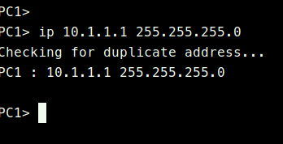

# Primer video - arranque y prueba de ping

## Cambio de simbolos

- clic derecho - change symbol

## Crear grid
- View - snap to grid - show grid

## Mostrar etiquetas de interfaces
- View - show/hide interfaces

## Encender la simulación con todos los dispositivos
- Pulsa el botón play
- hacer clic sobre un disposito 

## Poner IP

### Show ip
``` 
show ip 
```

### Save config
- no se guarda por defecto, hay que guardar en la consola con el comando save