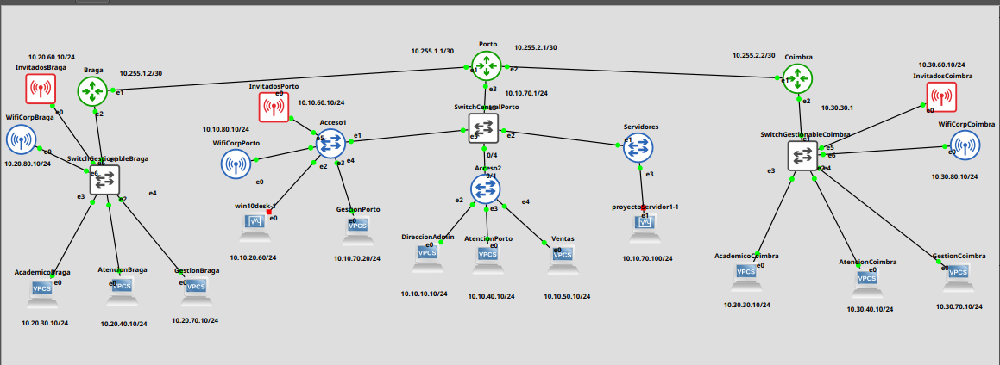
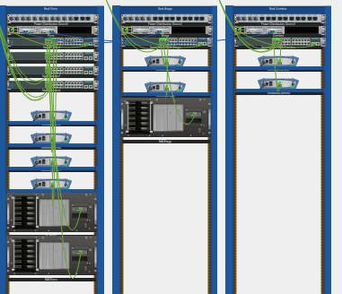

# NovaLingua School — Infraestructura Informática Multisede

Proyecto integrador de diseño e implementación de una infraestructura informática para **NovaLingua School**, una empresa ficticia dedicada a la enseñanza de idiomas con sedes en **Porto, Braga y Coimbra**.

El proyecto simula un entorno empresarial completo utilizando segmentación mediante VLANs, enrutamiento dinámico OSPF, firewall, Windows Server, Active Directory, DNS, políticas de grupo, recursos compartidos, MySQL y servicios web.



---

## Objetivos del proyecto

El objetivo principal fue diseñar una infraestructura capaz de proporcionar:

- Comunicación entre varias sedes.
- Segmentación de red por departamentos.
- Enrutamiento dinámico entre routers.
- Control de acceso entre redes.
- Gestión centralizada de usuarios y equipos.
- Resolución DNS interna.
- Recursos compartidos corporativos.
- Aplicación de políticas mediante GPO.
- Base de datos para la gestión académica.
- Servicios web internos.
- Documentación y pruebas de funcionamiento.

---

## Arquitectura general

La infraestructura está compuesta por tres sedes:

| Sede | Función |
|---|---|
| **Porto** | Sede principal y servicios centrales |
| **Braga** | Sede secundaria |
| **Coimbra** | Sede secundaria |

Los routers de las tres sedes fueron implementados con **OpenWrt dentro de GNS3**.

Porto actúa como sede central y se conecta con Braga y Coimbra mediante enlaces punto a punto.

```text
                 Braga
                   |
            10.255.1.0/30
                   |
                   |
                 Porto
                   |
            10.255.2.0/30
                   |
                   |
                Coimbra
```

El intercambio de rutas se realiza mediante **OSPF área 0 utilizando FRRouting**.

---

## Segmentación mediante VLANs

La infraestructura utiliza VLANs para separar departamentos, servicios y distintos tipos de usuarios.

### Porto

| VLAN | Función | Red |
|---:|---|---|
| 10 | Dirección / Administración | `10.10.10.0/24` |
| 20 | Desarrollo | `10.10.20.0/24` |
| 40 | Atención al Cliente | `10.10.40.0/24` |
| 50 | Marketing / Ventas | `10.10.50.0/24` |
| 60 | Invitados | `10.10.60.0/24` |
| 70 | Gestión / Servidores | `10.10.70.0/24` |
| 80 | Wi-Fi Corporativo | `10.10.80.0/24` |

### Braga

| VLAN | Función | Red |
|---:|---|---|
| 30 | Académico | `10.20.30.0/24` |
| 40 | Atención al Cliente | `10.20.40.0/24` |
| 60 | Invitados | `10.20.60.0/24` |
| 70 | Gestión | `10.20.70.0/24` |
| 80 | Wi-Fi Corporativo | `10.20.80.0/24` |

### Coimbra

| VLAN | Función | Red |
|---:|---|---|
| 30 | Académico | `10.30.30.0/24` |
| 40 | Atención al Cliente | `10.30.40.0/24` |
| 60 | Invitados | `10.30.60.0/24` |
| 70 | Gestión | `10.30.70.0/24` |
| 80 | Wi-Fi Corporativo | `10.30.80.0/24` |

Los diagramas completos pueden consultarse en [`diagrams/`](diagrams/).

---

## Enrutamiento dinámico

Se utilizó **FRRouting (FRR)** para implementar OSPF entre las tres sedes.

Cada router anuncia:

- Sus redes VLAN locales.
- Los enlaces punto a punto entre sedes.
- Las rutas necesarias para permitir comunicación entre las diferentes ubicaciones.

Router IDs utilizados:

```text
Porto   → 1.1.1.1
Braga   → 2.2.2.2
Coimbra → 3.3.3.3
```

Las configuraciones reconstruidas se encuentran en:

[`ospf`](configs/ospf).

---

## Seguridad y firewall

Los routers OpenWrt utilizan **nftables** para controlar el tráfico entre las distintas VLANs.

Entre las políticas implementadas se incluyen:

- Bloqueo de la VLAN de invitados hacia redes internas.
- Protección de las VLANs de gestión y servidores.
- Separación del Wi-Fi corporativo respecto a las VLANs cableadas.
- Permiso de tráfico perteneciente a conexiones `established,related`.

> La implementación original utiliza una política general `accept` con reglas específicas de bloqueo. Por tanto, se trata de un modelo de filtrado selectivo y no de una política estricta de denegación por defecto.

Las reglas se encuentran en:

[`nftables`](configs/nftables)

---

## Windows Server y Active Directory

La sede de Porto dispone de un servidor **Windows Server 2019** ubicado en la VLAN 70.

El servidor fue utilizado para implementar:

- Active Directory Domain Services.
- Controlador de dominio.
- DNS interno.
- Gestión centralizada de usuarios.
- Unidades organizativas.
- Recursos compartidos.
- Group Policy Objects.
- Integración de clientes Windows.

Dominio utilizado:

```text
novalingua.local
```

La estructura de Active Directory separa departamentos técnicos, departamentos no técnicos, IT, equipos y servidores.

También se utilizó un cliente Windows unido al dominio para validar:

- Resolución DNS.
- Inicio de sesión de usuarios.
- Acceso a recursos.
- Aplicación de GPOs.

---

## Políticas de grupo

Durante el proyecto se configuraron diferentes políticas mediante GPO, entre ellas:

- Política de contraseñas.
- Bloqueo del Panel de Control para usuarios no técnicos.
- Fondo de pantalla corporativo.
- Mensaje previo al inicio de sesión.
- Restricciones de CMD.
- Mapeo de carpetas compartidas.

El mapeo automático de unidades de red presentó algunos problemas durante determinadas pruebas, aunque los recursos compartidos podían ser accedidos desde los clientes.

---

## Base de datos MySQL

Se desarrolló la base de datos:

```text
novalingua_school
```

Su objetivo era representar parte de la gestión académica y administrativa de NovaLingua School.

El modelo incluye las tablas:

```text
alumno_info
alumno_curso
curso
profesor
sede
empleado
material
progreso_alumno
incidencia
```

Se implementaron:

- Claves primarias.
- Índices.
- Claves foráneas.
- Relaciones uno-a-muchos.
- Relación muchos-a-muchos entre alumnos y cursos.
- Restricciones `ON DELETE CASCADE`.
- Restricciones `ON DELETE SET NULL`.

El esquema público puede consultarse en:

[`configs/sql/novalingua-schema.sql`](configs/sql/novalingua-schema.sql)

Los datos de prueba y credenciales utilizadas durante el desarrollo original fueron eliminados de la versión pública del repositorio.

---

## Aplicación web

El proyecto también incluye el código fuente de la página web desarrollada para NovaLingua School.

El código se encuentra en:

[`landing page`](web/novalingua-site/landing-page-novalingua/landing-page-novalingua/)

El proyecto web contiene la interfaz desarrollada para representar la presencia digital de NovaLingua School.

Durante las pruebas de la infraestructura, el servicio web fue validado correctamente tanto desde el propio servidor como desde un **cliente Windows conectado a la red**.

Esto permitió comprobar que el servicio era accesible desde otro equipo dentro de la infraestructura y no únicamente de forma local.

---

## Pruebas realizadas

Durante el proyecto se realizaron pruebas sobre los principales componentes de la infraestructura.

| Área | Resultado |
|---|---|
| Conectividad entre VLANs | Correcto |
| OSPF entre sedes | Correcto |
| Firewall entre VLANs | Correcto |
| Windows Server | Correcto |
| Active Directory | Correcto |
| DNS | Correcto |
| Cliente unido al dominio | Correcto |
| GPOs | Correcto |
| MySQL | Correcto |
| Servicio web desde cliente | Correcto |
| Recursos compartidos | Parcial |

La documentación completa de las pruebas puede consultarse en:

[`docs/reportaje-final.md`](docs/reportaje-final.md)

---

## Tecnologías utilizadas

| Área | Tecnología |
|---|---|
| Simulación de red | GNS3 |
| Routers | OpenWrt |
| Enrutamiento | OSPF / FRRouting |
| Segmentación | VLAN 802.1Q |
| Firewall | nftables |
| Virtualización | VirtualBox / GNS3 VM |
| Servidor | Windows Server 2019 |
| Directorio | Active Directory |
| DNS | Windows DNS Server |
| Políticas | Group Policy |
| Base de datos | MySQL |
| Servicio web | IIS / PHP |
| Frontend | Astro / TypeScript |
| Cliente | Windows 10/11 |
| Diseño de red | Packet Tracer / draw.io |

---

## Estructura del repositorio

```text
NovaLingua-Infrastructure/
├── README.md
│
├── configs/
│   ├── README.md
│   ├── openwrt/
│   ├── ospf/
│   ├── nftables/
│   └── sql/
│
├── diagrams/
│   ├── gns3/
│   ├── logical/
│   ├── packet-tracer/
│   └── physical/
│
├── docs/
│   ├── full-project-report.md
│   └── design/
│
├── gns3/
│   ├── README.md
│   └── proyecto-novalingua/
│
├── packet-tracer/
│   └── novalingua.pkt
│
└── web/
    └── landing-page-novalingua/
```

---

## Proyecto GNS3

El repositorio incluye una copia del proyecto GNS3 utilizado para construir la infraestructura.

Se encuentra en:

[`gns3/`](gns3/)

Las imágenes de máquinas virtuales y appliances no están incluidas debido a su tamaño y a posibles restricciones de distribución.

Las instrucciones adicionales pueden consultarse en:

[`gns3/READMEGNS.md`](gns3/READMEGNS.md)

---

## Packet Tracer

También se conserva el proyecto original utilizado durante la fase de diseño con Cisco Packet Tracer:

```text
packet-tracer/
└── novalingua.pkt
```

Este proyecto complementa los diagramas y permite consultar parte del diseño de red utilizado durante la planificación de la infraestructura.

---

## Diagramas

### Topología GNS3


### Diseño físico



Además, el repositorio incluye:

- Diagramas lógicos editables de Porto, Braga y Coimbra.
- Diagramas desarrollados durante la fase de diseño con Packet Tracer.
- Topología utilizada en GNS3.
- Diseño físico de los racks e infraestructura.

Los archivos se encuentran organizados en:

```text
diagrams/
├── gns3/
├── logical/
├── packet-tracer/
└── physical/
```

---

## Configuraciones

Las principales configuraciones técnicas utilizadas durante el proyecto se encuentran en:

[`configs/`](configs/)

Incluyen:

```text
configs/
├── openwrt/
├── ospf/
├── nftables/
└── sql/
```

### OpenWrt

Contiene la configuración de red de los routers de:

- Porto.
- Braga.
- Coimbra.

### OSPF

Contiene la configuración de FRRouting utilizada para anunciar las redes de cada sede mediante OSPF.

### nftables

Contiene las reglas de filtrado utilizadas en los routers OpenWrt.

### SQL

Contiene el esquema público de la base de datos `novalingua_school`.

> Estas configuraciones fueron reconstruidas a partir de la documentación técnica del proyecto original y no representan exportaciones recientes de los sistemas.

---

## Documentación completa

Este README funciona como resumen técnico del proyecto.

La documentación extensa, incluyendo diseño, implementación, comandos, pruebas, políticas, presupuesto y anexos, se conserva en:

[`docs/reportaje-final.md`](docs/reportaje-final.md)

También se conserva documentación adicional relacionada con el diseño y presupuesto del proyecto dentro de:

```text
docs/design/
```

---

## Contexto del proyecto

Este proyecto fue desarrollado originalmente como proyecto integrador de final de curso.

Aunque administrativamente fue presentado como un trabajo de cuatro integrantes, la implementación técnica y la documentación contenida en este repositorio fueron realizadas principalmente por **Alex Baier y Beatriz Moreno**.

### Contribuciones principales

**Alex Baier**

- Diseño e implementación de la infraestructura.
- Configuración de GNS3.
- Configuración de OpenWrt.
- VLANs y direccionamiento.
- OSPF mediante FRRouting.
- Configuración de nftables.
- Windows Server.
- Active Directory.
- DNS.
- GPOs.
- Recursos compartidos.
- MySQL.
- Pruebas de infraestructura.
- Documentación técnica.

**Beatriz Moreno**

- Diseño y desarrollo de la página web.
- Implementación de la interfaz.
- Configuración del proyecto web.
- Desarrollo de funcionalidades web.
- Pruebas relacionadas con la aplicación web.

---

## Estado del proyecto

El proyecto fue completado como entorno académico de laboratorio.

Se consiguió implementar y validar la mayor parte de los componentes previstos, incluyendo:

- Comunicación multisede.
- VLANs.
- OSPF.
- Firewall.
- Windows Server.
- Active Directory.
- DNS.
- Cliente unido al dominio.
- Políticas de grupo.
- Base de datos MySQL.
- Acceso al servicio web desde un cliente de la red.

Algunas funcionalidades relacionadas con el mapeo automático de recursos compartidos mediante GPO presentaron problemas durante las pruebas.

Actualmente el entorno completo no se encuentra desplegado, por lo que algunas configuraciones del repositorio han sido reconstruidas a partir de la documentación original.

---

## Transparencia sobre el uso de IA

Se utilizó inteligencia artificial como herramienta de apoyo para mejorar la claridad, la redacción y la corrección gramatical de la documentación.

La IA no se utilizó para diseñar la infraestructura, tomar decisiones técnicas ni generar el contenido original del proyecto.

Las configuraciones, pruebas, decisiones técnicas y documentación base fueron realizadas previamente por los integrantes responsables del proyecto.
