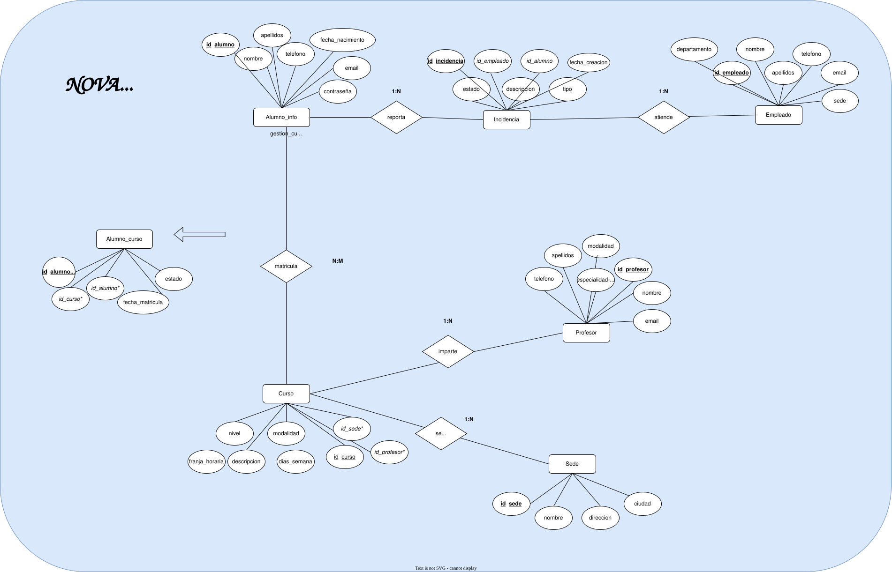

# MODELO ENTIDAD-RELACION

# MODELO RELACIONAL

### 1. Tabla: alumno_info
* **id_alumno** (PK) `INT`
* nombre `VARCHAR(50)`
* apellidos `VARCHAR(100)`
* telefono `VARCHAR(20)`
* fecha_nacimiento `DATE`
* email `VARCHAR(100)`
* contraseña `VARCHAR(255)`

### 2. Tabla: curso
*oferta académica disponible*
* **id_curso** (PK) `INT`
* descripcion `TEXT`
* nivel `ENUM`
* modalidad `ENUM`
* dias_semana `ENUM`
* franja_horaria `VARCHAR(50)`
* *id_profesor* (FK -> profesor.id_profesor) `INT`
* *id_sede* (FK -> sede.id_sede) `INT`

### 3. Tabla: alumno_curso
*Tabla intermedia*
* **id_alumno_curso** (PK) `INT`
* *id_alumno* (FK -> alumno_info.id_alumno) `INT`
* *id_curso* (FK -> curso.id_curso) `INT`
* fecha_matricula `DATETIME`
* estado `ENUM`

### 4. Tabla: profesor
* **id_profesor** (PK) `INT`
* nombre `VARCHAR(50)`
* apellidos `VARCHAR(100)`
* telefono `VARCHAR(20)`
* email `VARCHAR(100)`
* especialidad_idioma `ENUM`
* modalidad `ENUM`

### 5. Tabla: sede
* **id_sede** (PK) `INT`
* nombre `VARCHAR(50)`
* direccion `VARCHAR(150)`
* ciudad `VARCHAR(50)`

### 6. Tabla: empleado
*personal administrativo de la plataforma*
* **id_empleado** (PK) `INT`
* nombre `VARCHAR(50)`
* apellidos `VARCHAR(100)`
* telefono `VARCHAR(20)`
* email `VARCHAR(100)`
* departamento `VARCHAR(50)`
* sede `ENUM`

### 7. Tabla: incidencia
*soporte técnico*
* **id_incidencia** (PK) `INT`
* descripcion `TEXT`
* tipo `ENUM`
* estado `ENUM`
* fecha_creacion `DATETIME`
* *id_alumno* (FK -> alumno_info.id_alumno) `INT`
* *id_empleado* (FK -> empleado.id_empleado) `INT`