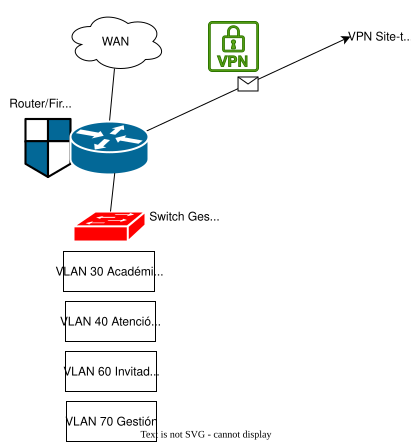
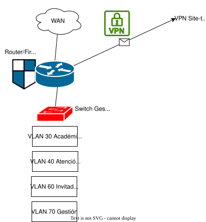

# Plantilla para el diseño lógico de la red e infraestructura informática

Plantilla para el diseño lógico de la red e infraestructura informática de una empresa ficticia. Debes adaptarla a tu proyecto.

## 🧠 1. Topología de red

- **Tipo:** Estrella jerárquica (la más común)
- **Componentes lógicos:**
  - Router principal (salida a Internet)
  - Switch central (Porto)
  - Switches de acceso por departamento

### Porto
| VLAN | Nombre | Network | Gateway |
| ---: | ------ | ------- | ------- |
| 10 | Dirección-Administración | `10.10.10.0/24` | `10.10.10.1` |
| 20 | Desarrollo-Plataforma | `10.10.20.0/24` | `10.10.20.1` |
| 40 | Atención-Cliente | `10.10.40.0/24` | `10.10.40.1` |
| 50 | Marketing-Ventas | `10.10.50.0/24` | `10.10.50.1` |
| 60 | Invitados | `10.10.60.0/24` | `10.10.60.1` |
| 70 | Gestión de red y Servidores | `10.10.70.0/24` | `10.10.70.1` |

### Braga

| VLAN | Nombre | Network | Gateway |
| ---: | ------ | ------- | ------- |
| 30 | Académico | `10.20.30.0/24` | `10.20.30.1` |
| 40 | Atención-Cliente | `10.20.40.0/24` | `10.20.40.1` |
| 60 | Invitados | `10.20.60.0/24` | `10.20.60.1` |
| 70 | Gestión de red | `10.20.70.0/24` | `10.20.70.1` |

### Coimbra
| VLAN | Nombre | Network | Gateway |
| ---: | ------ | ------- | ------- |
| 30 | Académico | `10.30.30.0/24` | `10.30.30.1` |
| 40 | Atención-Cliente | `10.30.40.0/24` | `10.30.40.1` |
| 60 | Invitados | `10.30.60.0/24` | `10.30.60.1` |
| 70 | Gestión de red | `10.30.70.0/24` | `10.30.70.1` |

## 🖥️ 3. Servidores y Servicios Lógicos

Los servicios principales estarán centralizados en la sede de Porto, dentro de la VLAN 70 - Gestión de red y Servidores. Estos servicios se ejecutarán como máquinas virtuales sobre el servidor físico Dell PowerEdge T360 mediante Proxmox VE. Las sedes de Braga y Coimbra accederán a estos servicios a través de la VPN site-to-site.

| Servicio | Nombre VM / Equipo | IP estimada | Sistema Operativo | Función principal |
|---|---|---|---|---|
| Active Directory / DNS | DC01 | `10.10.70.10` | Windows Server | Control de dominio, usuarios, grupos, políticas y resolución DNS interna |
| DHCP | DHCP01 | `10.10.70.1` | Router | Asignación automática de IPs por VLAN |
| Servidor de archivos | FILE01 | `10.10.70.20` | Windows Server | Carpetas compartidas, documentación interna y recursos por departamento |
| Web / LMS | WEB01 | `10.10.70.30` | Ubuntu Server + Apache/Nginx | Web corporativa, acceso a plataforma online y servicios internos |
| Base de datos | DB01 | `10.10.70.40` | Ubuntu Server + MySQL/MariaDB | Base de datos de alumnos, profesores, clases, horarios y asignaciones |
| NAS principal | NAS-PORTO | `10.10.70.50` | Synology DSM | Almacenamiento compartido, copias locales y snapshots |
| NAS respaldo | NAS-BRAGA | `10.20.70.50` | Synology DSM | Replicación externa de backups desde Porto |

## 🔒 4. Seguridad Lógica

### Firewall 
Controla tráfico entre VLANs e Internet. La seguridad perimetral se gestionará mediante los routers/firewalls UniFi instalados en cada sede. En Porto se utilizará el gateway principal como firewall central, mientras que Braga y Coimbra tendrán gateways propios conectados a Porto mediante VPN site-to-site.
### VPN

Se implementarán conexiones **VPN site-to-site** entre las sedes de Porto, Braga y Coimbra para permitir la comunicación segura entre oficinas. La sede de Porto actuará como sede central, ya que allí se encuentran los servidores principales, la VLAN de gestión y servidores, el NAS principal y los servicios internos.

Para la VPN entre sedes se utilizará **IPsec/IKEv2**, ya que es un estándar ampliamente utilizado en entornos empresariales y compatible con routers/firewalls profesionales. La comunicación irá cifrada mediante algoritmos seguros, evitando que el tráfico interno viaje en claro a través de Internet.

Como configuración base, se propone:

| Elemento | Configuración recomendada |
|---|---|
| Tipo de VPN | Site-to-site |
| Protocolo | IPsec con IKEv2 |
| Cifrado | AES-256 |
| Integridad | SHA-256 |
| Intercambio de claves | Diffie-Hellman grupo 14 o superior |
| Autenticación | Clave precompartida segura o certificados |
| Sedes conectadas | Porto-Braga y Porto-Coimbra |
| Topología | Hub-and-spoke, con Porto como sede central |
| Acceso remoto | VPN remota para empleados autorizados |
| Responsable | IT / Sistemas |

La topología será de tipo **hub-and-spoke**, donde Braga y Coimbra se conectarán directamente con Porto. Esto simplifica la administración, ya que los servicios principales están centralizados en Porto y las sedes secundarias no necesitan comunicarse directamente entre sí salvo que sea necesario.
Además de la VPN site-to-site, se habilitará una **VPN de acceso remoto** para empleados autorizados que trabajen fuera de la oficina. Para este acceso remoto se podrá utilizar **WireGuard**, **OpenVPN** o la solución VPN integrada en UniFi, aplicando autenticación mediante credenciales corporativas y MFA.
El acceso por VPN estará limitado según el rol del usuario. Por ejemplo, un profesor remoto podrá acceder a la plataforma LMS y recursos académicos, mientras que el personal de IT tendrá acceso a la red de gestión y servidores. La red de invitados no tendrá acceso a la VPN ni a los recursos internos.

Además, se habilitará una **VPN de acceso remoto** para empleados autorizados que trabajen fuera de la oficina. El acceso remoto estará protegido mediante credenciales corporativas.
### Política de contraseñas y permisos
La empresa utilizará autenticación centralizada mediante Active Directory. Cada empleado tendrá una cuenta individual y los permisos se asignarán mediante grupos según su departamento.Las contraseñas deberán tener una longitud mínima de 10 caracteres e incluir mayúsculas, minúsculas, números y símbolos. Se bloqueará la cuenta tras varios intentos fallidos.
Los permisos seguirán el principio de mínimo privilegio. Cada usuario solo tendrá acceso a los recursos necesarios para su trabajo. El departamento de IT / Sistemas tendrá acceso a la gestión de red, servidores, copias de seguridad y administración de usuarios. Desarrollo tendrá acceso a los recursos necesarios para la plataforma online. Dirección y Administración no tendrá acceso directo a los servidores internos, sino únicamente a las aplicaciones autorizadas. La red de invitados estará aislada y solo tendrá acceso a Internet.
### Antivirus 
Windows Defender para negocios - simplifica la gestión de seguriad y libera tiempo para enfocarse en otras tareas. Se propagará desde AD a todos los equipos de la red. 
### Copias de seguridad 
Se implementará una política de copias de seguridad sencilla y centralizada. Las copias principales se almacenarán en el NAS de Porto y se replicarán externamente hacia el NAS de respaldo situado en Braga.
Se realizará **una copia incremental diaria** de los cambios y **una copia completa semanal** de los datos críticos, incluyendo servidores, base de datos, plataforma web/LMS y carpetas compartidas. La replicación externa permitirá conservar una copia fuera de la sede principal en caso de fallo grave en Porto.
La gestión y revisión de las copias será responsabilidad del departamento de IT / Sistemas.

## ☁️ 5. Acceso a Internet y Servicios Externos

- Router/firewall con NAT y reglas personalizadas
- Servidor DNS externo (Google: `8.8.8.8`)

## 📐 6. Esquema lógico (diagrama)

### Esquemáticas iniciales con Draw.io

### Esquemática Packet Tracer
