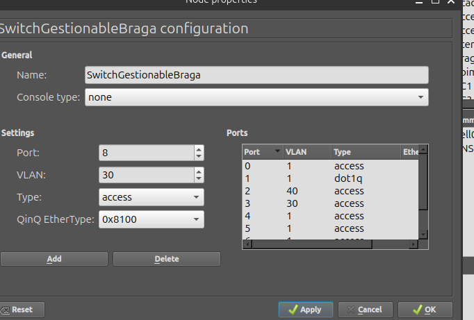

# Instalar GUI en Linux

1. Encontrar el enlace oficial de descarga
- https://docs.gns3.com/docs/getting-started/installation/linux/

2. Descargar la PPA y paquete
```bash
sudo add-apt-repository ppa:gns3/ppa
sudo apt update                                
sudo apt install gns3-gui gns3-server
```

3. Al entrar en la interfaz gráfica se selecciona "Run appliances on my local computer"

4. Seleccionar las configuraciones por defécto de server path, host binding, y port

# Instalar GNS VM para VirtualBox

1. Seleccionar la ISO que corresponda al hipervisor desde el enlace oficial
- https://gns3.com/software/download-vm

2. Descomprimir la carpeta y crea la máquina virtual (Importar - Seleccionar la OVA)

# Cambiar los ajustes de GNS para habilitar el uso de VM

1. Edit - Preferences

2. Habilitar VM

3. Servicio - VirtualBox

4. Nombre - GNS3 VM

5. Aplicar y aceptar

## Ajustes VirtualBox

1. Settings - tools - network

2. Host only adapter - DHCP - Habilitar


# Configuración de enrutamiento entre los routers
## Porto
```bash
ip addr add 10.255.1.1/30 dev eth1
ip link set eth0 up

ip addr add 10.255.2.1/30 dev eth2
ip link set eth1 up
```
## Braga
```bash
ip addr add 10.255.1.2/30 dev eth1
ip link set eth0 up
```
## Coimbra
```bash
ip addr add 10.255.2.2/30 dev eth1
ip link set eth0 up
```

# LAN de Porto
## Router
```bash
ip addr flush dev eth3
ip link set eth3 up
ip addr add 10.10.70.1/24 dev eth3
```

## PC test
```bash
ip 10.10.70.10/24 10.10.70.1
save
```

# LAN de Braga
## Router
```bash
ip addr flush dev eth2
ip link set eth2 up
ip addr add 10.20.30.1/24 dev eth2
```
## PC test
```bash
ip 10.20.30.10/24 10.20.30.1
save
```
# LAN de Coimbra
## Router
```bash
ip addr flush dev eth2
ip link set eth2 up
ip addr add 10.30.30.1/24 dev eth2
```

## PC test
```bash
ip 10.30.30.10/24 10.30.30.1
save
```

# Enrutamiento OSPF

## Instalación de paquete

1. Conectar cada router a un nodo NAT

```bash
ip link set eth4 up
udhcpc -i eth4
echo "nameserver 8.8.8.8" > /etc/resolv.conf
apk update # o wget -O- https://downloads.openwrt.org
apk add frr frr-ospfd
```

## Comandos de rutas

### Port Forwarding

```bash
# en cada router
sysctl -w net.ipv4.ip_forward=1
```

### Arranque de FRR

```bash
/etc/init.d/frr enable
/etc/init.d/frr start
```

#### Si hay problemas

```bash
# Comprobar si vtysh existe
which vtysh

# Actualizar paquetes
apk update

# Instalar FRR y OSPF
apk add frr frr-ospfd

# Instalar nano
apk add nano

# Editar archivo de demonios FRR
nano /etc/frr/daemons

# Dentro del archivo, cambiar:
# ospfd=no
# por:
# ospfd=yes

# Guardar en nano:
# Ctrl + O
# Enter
# Ctrl + X

# Parar FRR
/etc/init.d/frr stop

# Si hiciera falta limpiar procesos antiguos
killall watchfrr
killall zebra
killall ospfd

# Arrancar FRR
/etc/init.d/frr start

# Verificar que OSPF está arrancando
ps | grep ospf
ps | grep frr

# Entrar a FRR
vtysh

# Comprobar OSPF dentro de vtysh
show ip ospf
show ip ospf neighbor
```

### Porto

```bash
configure terminal
router ospf
 ospf router-id 1.1.1.1
 network 10.255.1.0/30 area 0
 network 10.255.2.0/30 area 0
 network 10.10.70.0/24 area 0
exit
copy running-config startup-config
exit
```

### Braga

```bash
configure terminal
router ospf
 ospf router-id 2.2.2.2
 network 10.255.1.0/30 area 0
 network 10.20.30.0/24 area 0
exit
copy running-config startup-config
exit
```

### Coimbra

```bash
configure terminal
router ospf
 ospf router-id 3.3.3.3
 network 10.255.2.0/30 area 0
 network 10.30.30.0/24 area 0
exit
copy running-config startup-config
exit
```

### Guardar config permanentemente

```bash
# =========================
# PORTO - guardar interfaces permanentemente
# =========================

uci set network.porto_braga=interface
uci set network.porto_braga.proto='static'
uci set network.porto_braga.device='eth1'
uci set network.porto_braga.ipaddr='10.255.1.1'
uci set network.porto_braga.netmask='255.255.255.252'

uci set network.porto_coimbra=interface
uci set network.porto_coimbra.proto='static'
uci set network.porto_coimbra.device='eth2'
uci set network.porto_coimbra.ipaddr='10.255.2.1'
uci set network.porto_coimbra.netmask='255.255.255.252'

uci delete network.wan
uci delete network.wan6

uci commit network
/etc/init.d/network restart

# =========================
# BRAGA - guardar interfaces permanentemente
# =========================

uci set network.braga_porto=interface
uci set network.braga_porto.proto='static'
uci set network.braga_porto.device='eth1'
uci set network.braga_porto.ipaddr='10.255.1.2'
uci set network.braga_porto.netmask='255.255.255.252'

uci delete network.wan
uci delete network.wan6

uci commit network
/etc/init.d/network restart

# =========================
# COIMBRA - guardar interfaces permanentemente
# =========================

uci set network.coimbra_porto=interface
uci set network.coimbra_porto.proto='static'
uci set network.coimbra_porto.device='eth1'
uci set network.coimbra_porto.ipaddr='10.255.2.2'
uci set network.coimbra_porto.netmask='255.255.255.252'

uci delete network.wan
uci delete network.wan6

uci commit network
/etc/init.d/network restart

# =========================
# EN TODOS LOS ROUTERS - activar forwarding permanentemente
# =========================

echo "net.ipv4.ip_forward=1" >> /etc/sysctl.conf
sysctl -p

# =========================
# COMPROBAR QUE SE GUARDÓ
# =========================

uci show network
ip addr
ip route
```

# Instalación resto de red Braga, Porto, Coimbra

- Se añaden switches acceso1, acceso2 y servidores a Porto.
- Se añade un PC más a Braga y Coimbra.
- Se añaden clientes simulados para invitados Wi-Fi y Wi-Fi corporativo.

# Creando VLAN

## Braga

```bash
# Remove old untagged IP from eth2
ip addr flush dev eth2
ip link set eth2 up

# Create VLAN 30 - Académico
ip link add link eth2 name eth2.30 type vlan id 30
ip link set eth2.30 up
ip addr add 10.20.30.1/24 dev eth2.30

# Create VLAN 40 - Atención Cliente
ip link add link eth2 name eth2.40 type vlan id 40
ip link set eth2.40 up
ip addr add 10.20.40.1/24 dev eth2.40

# VLAN 60 - Invitados Wi-Fi
ip link add link eth2 name eth2.60 type vlan id 60
ip link set eth2.60 up
ip addr add 10.20.60.1/24 dev eth2.60

# VLAN 70 - Gestión
ip link add link eth2 name eth2.70 type vlan id 70
ip link set eth2.70 up
ip addr add 10.20.70.1/24 dev eth2.70

# VLAN 80 - Wi-Fi Corporativo
ip link add link eth2 name eth2.80 type vlan id 80
ip link set eth2.80 up
ip addr add 10.20.80.1/24 dev eth2.80
```

### Configurar switch Braga

- eth1 - al router (vlan 1 / dot1q)
- eth2 - académico (vlan 30)
- eth3 - atención (vlan 40)
- eth4 - gestión (vlan 70)
- eth5 - invitados Wi-Fi (vlan 60)
- eth6 - Wi-Fi corporativo (vlan 80)



### Añadir rutas a OSPF

```bash
vtysh
configure terminal
router ospf
 network 10.20.40.0/24 area 0
 network 10.20.60.0/24 area 0
 network 10.20.70.0/24 area 0
 network 10.20.80.0/24 area 0
end
copy running-config startup-config
show ip route ospf
```

- Hacer ping desde Porto y Coimbra a:
  - `10.20.40.10`
  - `10.20.60.10`
  - `10.20.70.10`
  - `10.20.80.10`

## Coimbra

```bash
ip addr flush dev eth2
ip link set eth2 up

# VLAN 30 - Académico
ip link add link eth2 name eth2.30 type vlan id 30
ip link set eth2.30 up
ip addr add 10.30.30.1/24 dev eth2.30

# VLAN 40 - Atención Cliente
ip link add link eth2 name eth2.40 type vlan id 40
ip link set eth2.40 up
ip addr add 10.30.40.1/24 dev eth2.40

# VLAN 60 - Invitados Wi-Fi
ip link add link eth2 name eth2.60 type vlan id 60
ip link set eth2.60 up
ip addr add 10.30.60.1/24 dev eth2.60

# VLAN 70 - Gestión
ip link add link eth2 name eth2.70 type vlan id 70
ip link set eth2.70 up
ip addr add 10.30.70.1/24 dev eth2.70

# VLAN 80 - Wi-Fi Corporativo
ip link add link eth2 name eth2.80 type vlan id 80
ip link set eth2.80 up
ip addr add 10.30.80.1/24 dev eth2.80
```

### Configurar switch Coimbra

- eth1 - al router (vlan 1 / dot1q)
- eth2 - académico (vlan 30)
- eth3 - atención (vlan 40)
- eth4 - gestión (vlan 70)
- eth5 - invitados Wi-Fi (vlan 60)
- eth6 - Wi-Fi corporativo (vlan 80)

### Añadir rutas a OSPF

```bash
configure terminal
router ospf
 network 10.30.40.0/24 area 0
 network 10.30.60.0/24 area 0
 network 10.30.70.0/24 area 0
 network 10.30.80.0/24 area 0
end
copy running-config startup-config
show ip route ospf
```

- Hacer ping desde Porto y Braga a:
  - `10.30.40.10`
  - `10.30.60.10`
  - `10.30.70.10`
  - `10.30.80.10`

## Porto

```bash
ip addr flush dev eth3
ip link set eth3 up

ip link add link eth3 name eth3.10 type vlan id 10
ip link set eth3.10 up
ip addr add 10.10.10.1/24 dev eth3.10

ip link add link eth3 name eth3.20 type vlan id 20
ip link set eth3.20 up
ip addr add 10.10.20.1/24 dev eth3.20

ip link add link eth3 name eth3.40 type vlan id 40
ip link set eth3.40 up
ip addr add 10.10.40.1/24 dev eth3.40

ip link add link eth3 name eth3.50 type vlan id 50
ip link set eth3.50 up
ip addr add 10.10.50.1/24 dev eth3.50

ip link add link eth3 name eth3.60 type vlan id 60
ip link set eth3.60 up
ip addr add 10.10.60.1/24 dev eth3.60

ip link add link eth3 name eth3.70 type vlan id 70
ip link set eth3.70 up
ip addr add 10.10.70.1/24 dev eth3.70

ip link add link eth3 name eth3.80 type vlan id 80
ip link set eth3.80 up
ip addr add 10.10.80.1/24 dev eth3.80
```

### Switch central

| Central switch port | Connected to             | VLAN | Type    |
| ------------------: | ------------------------ | ---: | ------- |
|                `e3` | Porto router `eth3`      |  `1` | `dot1q` |
|                `e5` | Access switch 1 port 1   |  `1` | `dot1q` |
|                `e4` | Access switch 2 port 1   |  `1` | `dot1q` |
|                `e2` | Server/DMZ switch port 1 |  `1` | `dot1q` |

- Port 2: VLAN 1, type dot1q
- Port 3: VLAN 1, type dot1q
- Port 4: VLAN 1, type dot1q
- Port 5: VLAN 1, type dot1q

### Switch Servidores

| Server/DMZ switch port | Connected to        | VLAN | Type     |
| ---------------------: | ------------------- | ---: | -------- |
|                   `e1` | Central switch `e2` |  `1` | `dot1q`  |
|                   `e2` | Server/PC test      | `70` | `access` |

- Ping a la puerta de enlace y desde Braga.

### Switch acceso1

| Access Switch 1 port | Connected to        | VLAN | Type     |
| -------------------: | ------------------- | ---: | -------- |
|                 `e1` | Central switch `e5` |  `1` | `dot1q`  |
|                 `e2` | PC Desarrollo       | `20` | `access` |
|                 `e3` | Invitados PC        | `60` | `access` |
|                 `e4` | Gestión / IT PC     | `70` | `access` |
|                 `e5` | Wi-Fi Corporativo   | `80` | `access` |

- Ping a la puerta de enlace y `10.10.70.10`.

### Switch acceso2

| Access Switch 2 port | Connected to        | VLAN | Type     |
| -------------------: | ------------------- | ---: | -------- |
|                 `e1` | Central switch `e4` |  `1` | `dot1q`  |
|                 `e2` | PC Dirección/Admin  | `10` | `access` |
|                 `e3` | Atención Cliente PC | `40` | `access` |
|                 `e4` | Marketing/Ventas PC | `50` | `access` |

- Ping a la puerta de enlace y `10.10.70.10`.

## Añadir rutas OSPF a Porto

### Porto

```bash
configure terminal
router ospf
 network 10.10.10.0/24 area 0
 network 10.10.20.0/24 area 0
 network 10.10.40.0/24 area 0
 network 10.10.50.0/24 area 0
 network 10.10.60.0/24 area 0
 network 10.10.70.0/24 area 0
 network 10.10.80.0/24 area 0
end
copy running-config startup-config
show ip route ospf
```

- Comprobar desde PC Braga y Coimbra:
  - `ping 10.10.10.10`
  - `ping 10.10.20.10`
  - `ping 10.10.40.10`
  - `ping 10.10.50.10`
  - `ping 10.10.60.10`
  - `ping 10.10.70.10`
  - `ping 10.10.80.10`

# Guardar VLANs permanentemente

## Porto

```bash
uci set network.porto_vlan10=interface
uci set network.porto_vlan10.proto='static'
uci set network.porto_vlan10.device='eth3.10'
uci set network.porto_vlan10.ipaddr='10.10.10.1'
uci set network.porto_vlan10.netmask='255.255.255.0'

uci set network.porto_vlan20=interface
uci set network.porto_vlan20.proto='static'
uci set network.porto_vlan20.device='eth3.20'
uci set network.porto_vlan20.ipaddr='10.10.20.1'
uci set network.porto_vlan20.netmask='255.255.255.0'

uci set network.porto_vlan40=interface
uci set network.porto_vlan40.proto='static'
uci set network.porto_vlan40.device='eth3.40'
uci set network.porto_vlan40.ipaddr='10.10.40.1'
uci set network.porto_vlan40.netmask='255.255.255.0'

uci set network.porto_vlan50=interface
uci set network.porto_vlan50.proto='static'
uci set network.porto_vlan50.device='eth3.50'
uci set network.porto_vlan50.ipaddr='10.10.50.1'
uci set network.porto_vlan50.netmask='255.255.255.0'

uci set network.porto_vlan60=interface
uci set network.porto_vlan60.proto='static'
uci set network.porto_vlan60.device='eth3.60'
uci set network.porto_vlan60.ipaddr='10.10.60.1'
uci set network.porto_vlan60.netmask='255.255.255.0'

uci set network.porto_vlan70=interface
uci set network.porto_vlan70.proto='static'
uci set network.porto_vlan70.device='eth3.70'
uci set network.porto_vlan70.ipaddr='10.10.70.1'
uci set network.porto_vlan70.netmask='255.255.255.0'

uci set network.porto_vlan80=interface
uci set network.porto_vlan80.proto='static'
uci set network.porto_vlan80.device='eth3.80'
uci set network.porto_vlan80.ipaddr='10.10.80.1'
uci set network.porto_vlan80.netmask='255.255.255.0'

uci commit network
uci show network | grep porto_vlan
```

## Braga

```bash
uci set network.braga_vlan30=interface
uci set network.braga_vlan30.proto='static'
uci set network.braga_vlan30.device='eth2.30'
uci set network.braga_vlan30.ipaddr='10.20.30.1'
uci set network.braga_vlan30.netmask='255.255.255.0'

uci set network.braga_vlan40=interface
uci set network.braga_vlan40.proto='static'
uci set network.braga_vlan40.device='eth2.40'
uci set network.braga_vlan40.ipaddr='10.20.40.1'
uci set network.braga_vlan40.netmask='255.255.255.0'

uci set network.braga_vlan60=interface
uci set network.braga_vlan60.proto='static'
uci set network.braga_vlan60.device='eth2.60'
uci set network.braga_vlan60.ipaddr='10.20.60.1'
uci set network.braga_vlan60.netmask='255.255.255.0'

uci set network.braga_vlan70=interface
uci set network.braga_vlan70.proto='static'
uci set network.braga_vlan70.device='eth2.70'
uci set network.braga_vlan70.ipaddr='10.20.70.1'
uci set network.braga_vlan70.netmask='255.255.255.0'

uci set network.braga_vlan80=interface
uci set network.braga_vlan80.proto='static'
uci set network.braga_vlan80.device='eth2.80'
uci set network.braga_vlan80.ipaddr='10.20.80.1'
uci set network.braga_vlan80.netmask='255.255.255.0'

uci commit network
uci show network | grep braga_vlan
```

## Coimbra

```bash
uci set network.coimbra_vlan30=interface
uci set network.coimbra_vlan30.proto='static'
uci set network.coimbra_vlan30.device='eth2.30'
uci set network.coimbra_vlan30.ipaddr='10.30.30.1'
uci set network.coimbra_vlan30.netmask='255.255.255.0'

uci set network.coimbra_vlan40=interface
uci set network.coimbra_vlan40.proto='static'
uci set network.coimbra_vlan40.device='eth2.40'
uci set network.coimbra_vlan40.ipaddr='10.30.40.1'
uci set network.coimbra_vlan40.netmask='255.255.255.0'

uci set network.coimbra_vlan60=interface
uci set network.coimbra_vlan60.proto='static'
uci set network.coimbra_vlan60.device='eth2.60'
uci set network.coimbra_vlan60.ipaddr='10.30.60.1'
uci set network.coimbra_vlan60.netmask='255.255.255.0'

uci set network.coimbra_vlan70=interface
uci set network.coimbra_vlan70.proto='static'
uci set network.coimbra_vlan70.device='eth2.70'
uci set network.coimbra_vlan70.ipaddr='10.30.70.1'
uci set network.coimbra_vlan70.netmask='255.255.255.0'

uci set network.coimbra_vlan80=interface
uci set network.coimbra_vlan80.proto='static'
uci set network.coimbra_vlan80.device='eth2.80'
uci set network.coimbra_vlan80.ipaddr='10.30.80.1'
uci set network.coimbra_vlan80.netmask='255.255.255.0'

uci commit network
uci show network | grep coimbra_vlan
```

# Verificación tras reinicio

Después de reiniciar los routers o el proyecto de GNS3:

```bash
ip addr
ip route
vtysh
show ip ospf neighbor
show ip route ospf
```

Si OSPF o los pings fallan después del reinicio, limpiar reglas nftables y reiniciar FRR:

```bash
nft flush ruleset
/etc/init.d/frr restart
```

Volver a comprobar:

```bash
vtysh
show ip ospf neighbor
show ip route ospf
```

# Creación de firewalls

## Tabla

| Origen                   | Destino                          | Acción              | Motivo                                                                                |
| ------------------------ | -------------------------------- | ------------------- | ------------------------------------------------------------------------------------- |
| VLAN 10 Dirección/Admin  | VLAN 70 Servidores/Gestión       | Permitir limitado   | Acceso a servicios administrativos, archivos, autenticación y herramientas de gestión |
| VLAN 10 Dirección/Admin  | VLANs de usuarios/departamentos  | Denegar por defecto | Evitar acceso innecesario a redes de otros departamentos                              |
| VLAN 20 Desarrollo       | VLAN 70 Servidores/Gestión       | Permitir limitado   | Acceso a servidores, repositorios y servicios internos                                |
| VLAN 30 Académico        | VLAN 70 Servidores/Gestión       | Permitir limitado   | Acceso a LMS, autenticación, archivos y recursos académicos                           |
| VLAN 40 Atención Cliente | VLAN 70 Servidores/Gestión       | Permitir limitado   | Acceso a CRM, archivos compartidos y autenticación                                    |
| VLAN 50 Marketing/Ventas | VLAN 70 Servidores/Gestión       | Permitir limitado   | Acceso a recursos compartidos, CRM y herramientas corporativas                        |
| VLAN 60 Invitados        | Redes internas                   | Denegar             | Aislamiento de usuarios invitados                                                     |
| VLAN 60 Invitados        | Internet                         | Permitir            | Acceso básico a Internet para visitantes                                              |
| VLAN 70 Gestión          | Dispositivos de red y servidores | Permitir            | Administración de routers, switches, APs, NAS y servidores                            |
| VLAN 80 Wi-Fi Corporativo | VLAN 70 Servidores/Gestión      | Permitir limitado   | Acceso a autenticación, archivos, LMS, CRM y servicios corporativos necesarios        |
| VLAN 80 Wi-Fi Corporativo | VLANs de usuarios cableadas     | Denegar por defecto | Evitar movimiento lateral entre clientes inalámbricos y redes cableadas               |
| VLAN 80 Wi-Fi Corporativo | Internet                        | Permitir            | Acceso normal para empleados conectados al Wi-Fi corporativo                          |
| VLANs de usuarios        | VLAN 70 Gestión                  | Denegar por defecto | Evitar que usuarios normales administren infraestructura                              |
| Entre sedes              | VLANs y servicios necesarios     | Permitir limitado   | Comunicación entre Porto, Braga y Coimbra según necesidad                             |
| Cualquier VLAN           | Tráfico no definido              | Denegar por defecto | Aplicación del principio de mínimo privilegio                                         |

| Service          | Location / VLAN       |  Suggested IP | Notes                                          |
| ---------------- | --------------------- | ------------: | ---------------------------------------------- |
| Active Directory | Porto VLAN 70         | `10.10.70.10` | Optional/basic identity service if implemented |
| DNS              | External              |     `8.8.8.8` | No internal DNS server                         |
| DHCP             | Routers               | VLAN gateways | DHCP per VLAN from router/firewall             |
| File Server      | Porto VLAN 70         | `10.10.70.20` | Shared folders                                 |
| Web / LMS        | Porto VLAN 70         | `10.10.70.30` | Platform/server placeholder                    |
| Database         | Porto VLAN 70         | `10.10.70.40` | MySQL/MariaDB                                  |
| NAS Porto        | Porto VLAN 70         | `10.10.70.50` | Main backups                                   |
| NAS Braga        | Braga VLAN 70         | `10.20.70.50` | Backup replication                             |
| VPN              | Routers/firewalls     |             — | Site-to-site and remote access                 |
| Firewall         | All routers/firewalls |             — | VLAN isolation                                 |

## Paso 1: Bloquear VLAN 60 a acceso interno
### Porto
```bash
nft add table inet labfw
nft list tables
nft 'add chain inet labfw forward { type filter hook forward priority 0; policy accept; }'
nft list ruleset
nft add rule inet labfw forward ip saddr 10.10.60.0/24 ip daddr 10.0.0.0/8 drop
```
- ping 10.20.60.1 - funciona
- ping 10.10.70.10 - no funciona

### Braga
```bash
nft add table inet labfw
nft 'add chain inet labfw forward { type filter hook forward priority 0; policy accept; }'
nft add rule inet labfw forward ip saddr 10.20.60.0/24 ip daddr 10.0.0.0/8 drop
```
- ping 10.20.60.1 - funciona
- ping 10.10.70.10 - no funciona

### Coimbra
```bash
nft add table inet labfw
nft 'add chain inet labfw forward { type filter hook forward priority 0; policy accept; }'
nft add rule inet labfw forward ip saddr 10.30.60.0/24 ip daddr 10.0.0.0/8 drop
ping 10.30.60.1 #funciona
ping 10.10.70.10 #no
ping 10.20.30.10 #no
```

## Paso 2: Bloquear por defecto todo el tráfico a VLAN 70 (servidores)
### Porto
```bash
nft add rule inet labfw forward ip saddr 10.10.20.0/24 ip daddr 10.10.70.0/24 drop
nft add rule inet labfw forward ip saddr 10.10.10.0/24 ip daddr 10.10.70.0/24 drop
nft add rule inet labfw forward ip saddr 10.10.40.0/24 ip daddr 10.10.70.0/24 drop
nft add rule inet labfw forward ip saddr 10.10.50.0/24 ip daddr 10.10.70.0/24 drop
nft add rule inet labfw forward ip saddr 10.10.80.0/24 ip daddr 10.10.70.0/24 drop
#ping 10.10.70.10
```

### Braga
```bash
nft add rule inet labfw forward ip saddr 10.20.30.0/24 ip daddr 10.20.70.0/24 drop
nft add rule inet labfw forward ip saddr 10.20.40.0/24 ip daddr 10.20.70.0/24 drop
nft add rule inet labfw forward ip saddr 10.20.80.0/24 ip daddr 10.20.70.0/24 drop
#ping 10.20.70.10
```

### Coimbra
```bash
nft add rule inet labfw forward ip saddr 10.30.30.0/24 ip daddr 10.30.70.0/24 drop
nft add rule inet labfw forward ip saddr 10.30.40.0/24 ip daddr 10.30.70.0/24 drop
nft add rule inet labfw forward ip saddr 10.30.80.0/24 ip daddr 10.30.70.0/24 drop
#ping 10.30.70.10
```

## Paso 3: Bloquear tráfico desde VLAN 80
### Porto
```bash
nft add rule inet labfw forward ip saddr 10.10.80.0/24 ip daddr 10.10.10.0/24 drop
nft add rule inet labfw forward ip saddr 10.10.80.0/24 ip daddr 10.10.20.0/24 drop
nft add rule inet labfw forward ip saddr 10.10.80.0/24 ip daddr 10.10.40.0/24 drop
nft add rule inet labfw forward ip saddr 10.10.80.0/24 ip daddr 10.10.50.0/24 drop
#ping 10.20.80.1
#ping 10.20.30.10
#ping 10.20.40.10
#ping 10.20.70.10
```
### Braga
```bash
nft add rule inet labfw forward ip saddr 10.20.80.0/24 ip daddr 10.20.30.0/24 drop
nft add rule inet labfw forward ip saddr 10.20.80.0/24 ip daddr 10.20.40.0/24 drop
#ping 10.20.80.1
#ping 10.20.30.10
#ping 10.20.40.10
#ping 10.20.70.10
```

### Coimbra
```bash
nft add rule inet labfw forward ip saddr 10.30.80.0/24 ip daddr 10.30.30.0/24 drop
nft add rule inet labfw forward ip saddr 10.30.80.0/24 ip daddr 10.30.40.0/24 drop
#ping 10.30.80.1
#ping 10.30.30.10
#ping 10.30.40.10
#ping 10.30.70.10
```

## Paso 4: Guardar estado permanente
- en /etc/rc.local
### Porto
```bash
# Firewall lab rules - Porto

nft delete table inet labfw 2>/dev/null

nft add table inet labfw
nft 'add chain inet labfw forward { type filter hook forward priority 0; policy accept; }'

# Bloquear invitados VLAN 60 hacia redes internas
nft add rule inet labfw forward ip saddr 10.10.60.0/24 ip daddr 10.0.0.0/8 drop

# Bloquear VLANs de usuarios hacia VLAN 70 Gestión/Servidores local
nft add rule inet labfw forward ip saddr 10.10.10.0/24 ip daddr 10.10.70.0/24 drop
nft add rule inet labfw forward ip saddr 10.10.20.0/24 ip daddr 10.10.70.0/24 drop
nft add rule inet labfw forward ip saddr 10.10.40.0/24 ip daddr 10.10.70.0/24 drop
nft add rule inet labfw forward ip saddr 10.10.50.0/24 ip daddr 10.10.70.0/24 drop
nft add rule inet labfw forward ip saddr 10.10.80.0/24 ip daddr 10.10.70.0/24 drop

# Bloquear Wi-Fi corporativo VLAN 80 hacia VLANs cableadas locales
nft add rule inet labfw forward ip saddr 10.10.80.0/24 ip daddr 10.10.10.0/24 drop
nft add rule inet labfw forward ip saddr 10.10.80.0/24 ip daddr 10.10.20.0/24 drop
nft add rule inet labfw forward ip saddr 10.10.80.0/24 ip daddr 10.10.40.0/24 drop
nft add rule inet labfw forward ip saddr 10.10.80.0/24 ip daddr 10.10.50.0/24 drop
```
### Braga
```bash
# Firewall lab rules - Braga

nft delete table inet labfw 2>/dev/null

nft add table inet labfw
nft 'add chain inet labfw forward { type filter hook forward priority 0; policy accept; }'

# Bloquear invitados VLAN 60 hacia redes internas
nft add rule inet labfw forward ip saddr 10.20.60.0/24 ip daddr 10.0.0.0/8 drop

# Bloquear VLANs de usuarios hacia VLAN 70 Gestión local
nft add rule inet labfw forward ip saddr 10.20.30.0/24 ip daddr 10.20.70.0/24 drop
nft add rule inet labfw forward ip saddr 10.20.40.0/24 ip daddr 10.20.70.0/24 drop
nft add rule inet labfw forward ip saddr 10.20.80.0/24 ip daddr 10.20.70.0/24 drop

# Bloquear Wi-Fi corporativo VLAN 80 hacia VLANs cableadas locales
nft add rule inet labfw forward ip saddr 10.20.80.0/24 ip daddr 10.20.30.0/24 drop
nft add rule inet labfw forward ip saddr 10.20.80.0/24 ip daddr 10.20.40.0/24 drop
```
## Paso 5: Ajustar para cargar el cortafuegos al reiniciar
- Pon sleep 30 en la primera linea de /etc/rc.local en cada router
- En el caso que algo esté roto:
```bash
nft delete table inet labfw
nft flush ruleset
/etc/init.d/frr restart
/etc/rc.local #recarga firewall
```
# Config de primer servidor
- Máquina con un adaptador en NAT
1. Preferences - VirtualBox VMs - new
2. Añadir máquina desde la lista
3. Edit - let GNS use any adapter
4. En powershell
```powershell
New-NetFirewallRule -DisplayName "Allow ICMPv4 Echo" -Protocol ICMPv4 -IcmpType 8 -Action Allow
```
5. Añadir una regla established related para respuestas para conexiones ya establecidas desde el servidor
```bash
#!/bin/sh

sleep 30

# Firewall lab rules - Porto

nft delete table inet labfw 2>/dev/null

nft add table inet labfw
nft 'add chain inet labfw forward { type filter hook forward priority 0; policy accept; }'

# Permitir respuestas a conexiones ya iniciadas
nft add rule inet labfw forward ct state established,related accept

# Bloquear invitados VLAN 60 hacia redes internas
nft add rule inet labfw forward ip saddr 10.10.60.0/24 ip daddr 10.0.0.0/8 drop

# Bloquear VLANs de usuarios hacia VLAN 70 Gestión/Servidores local
nft add rule inet labfw forward ip saddr 10.10.10.0/24 ip daddr 10.10.70.0/24 drop
nft add rule inet labfw forward ip saddr 10.10.20.0/24 ip daddr 10.10.70.0/24 drop
nft add rule inet labfw forward ip saddr 10.10.40.0/24 ip daddr 10.10.70.0/24 drop
nft add rule inet labfw forward ip saddr 10.10.50.0/24 ip daddr 10.10.70.0/24 drop
nft add rule inet labfw forward ip saddr 10.10.80.0/24 ip daddr 10.10.70.0/24 drop
```
5. Pruebas de conectividad
| Prueba                                                        | Resultado esperado                                  | Resultado |
| ------------------------------------------------------------- | --------------------------------------------------- | --------- |
| Router Porto → Windows Server `10.10.70.100`                  | Funciona                                            | Superado  |
| Windows Server `10.10.70.100` → gateway `10.10.70.1`          | Funciona                                            | Superado  |
| Windows Server VLAN 70 → PC Desarrollo `10.10.20.10`          | Funciona tras añadir la regla `established,related` | Superado  |
| PC Desarrollo `10.10.20.10` → Windows Server `10.10.70.100`   | Falla / bloqueado                                   | Superado  |
| VLAN 60 Invitados → su propia puerta de enlace                | Funciona                                            | Superado  |
| VLAN 60 Invitados → redes internas / VLAN 70                  | Falla / bloqueado                                   | Superado  |
| VLAN 80 Wi-Fi Corporativo → su propia puerta de enlace        | Funciona                                            | Superado  |
| VLAN 80 Wi-Fi Corporativo → VLANs cableadas locales / VLAN 70 | Falla / bloqueado                                   | Superado  |
| VLAN 70 Gestión → VLANs internas                              | Funciona                                            | Superado  |

# Resumen de reglas hasta ahora
| Tipo de tráfico                                     | Resultado                           |
| --------------------------------------------------- | ----------------------------------- |
| Invitados VLAN 60 → redes internas                  | Bloqueado                           |
| VLANs de usuarios → VLAN 70 local                   | Bloqueado                           |
| Wi-Fi corporativo VLAN 80 → VLANs cableadas locales | Bloqueado                           |
| Wi-Fi corporativo VLAN 80 → VLAN 70 local           | Bloqueado                           |
| VLAN 70 Gestión/Servidores → redes internas         | Permitido                           |
| Respuestas a conexiones iniciadas por VLAN 70       | Permitido con `established,related` |
| OSPF entre routers                                  | Permitido                           |

# Si hay problemas con enrutamiento al reiniciar
```bash
nft delete table inet labfw
nft flush ruleset

/etc/rc.local